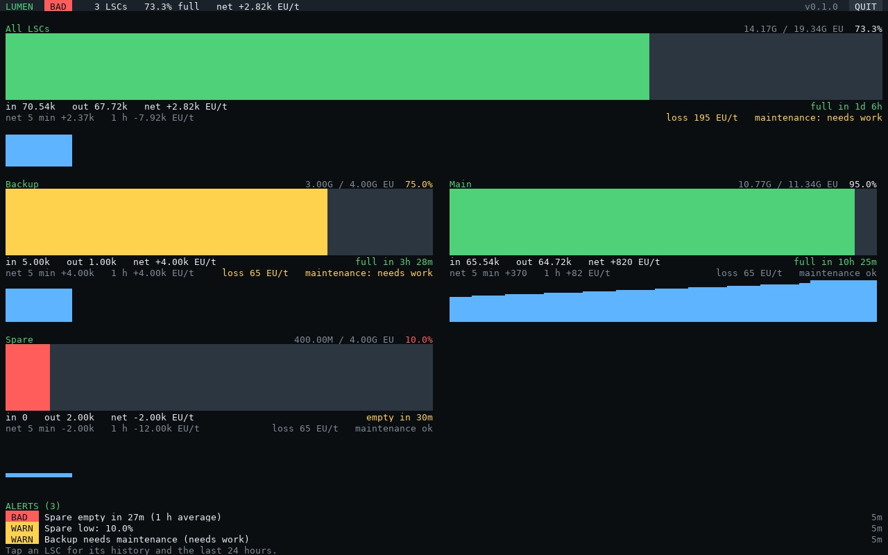

# LUMEN

**Load, Usage & Management of Energy Networks.** Power monitoring for **GregTech: New Horizons** on
**OpenComputers**: Lapotronic Supercapacitors, generators and the rest of a base's power, as GTNH
progresses.

**[Website](https://aharabedian.github.io/spectra/lumen/)** · **[Docs](https://aharabedian.github.io/spectra/lumen/docs/)** · [Changelog](CHANGELOG.md) · [Install](#install)

Part of **[SPECTRA](https://github.com/aharabedian/spectra)**, OpenComputers programs for running a GTNH base: 🟧 [PRISM](https://github.com/aharabedian/prism) (items) · 🟦 [LENS](https://github.com/aharabedian/lens) (monitoring) · **🟩 LUMEN** (power). Each runs on its own.

**`lumen`** shows every LSC a computer reaches on one screen, with history and alerts that don't cry wolf; shows
generators and IC2 reactors; switches generators on and off with the LSCs' fill (a redstone signal or a GT
machine); and can report to LENS.



## Scope

| In | Out |
|---|---|
| Reading LSCs and other GT energy storage: stored EU, input, output, time to full or empty | **Automated reactor control.** OpenComputers can't swap reactor components atomically; a mod built for it (Steve's Factory Manager) does it better |
| Simple, safe control: switching generators on and off with the LSC's fill | Anything that needs reactions faster than a computer polling every few seconds |
| Alerts (low power, draining fast), and reporting to LENS | |

## Install

On a computer with an Internet Card:

```
wget -f https://raw.githubusercontent.com/aharabedian/lumen/main/src/lumen-update.lua /home/lumen-update.lua
/home/lumen-update
```

Then **`lumen-setup`**, and run **`lumen`**. What you need, switches and the screen: [docs/setup.md](docs/setup.md).

| Program | Does |
|---|---|
| `lumen` | The power screen: every LSC's fill, flows, time to full or empty, history and the last 24 hours; generators and reactors; switches; alerts. Optionally reports to LENS |
| `lumen-setup` | Asks about your LSCs, generators, switches, alerts and LENS, and writes `/home/lumen.cfg` |
| `lumen-discover` | Lists components and their methods; `--read` shows what an LSC (or any GT machine) reports |
| `lumen-update` | Installs and updates LUMEN |

## Docs

| | |
|---|---|
| [Setup](docs/setup.md) | Hardware, install, running, the screen, switches |
| [Configuration](docs/configuration.md) | Every setting, sources, switches, the alerts, LENS metrics |
| [Architecture](docs/architecture.md) | Programs, modules, and what's been verified in game |

## Development

```
make dev      # install luacheck into .luarocks/ (once)
make check    # lint + tests
```

MIT licensed. See [CONTRIBUTING.md](CONTRIBUTING.md).
