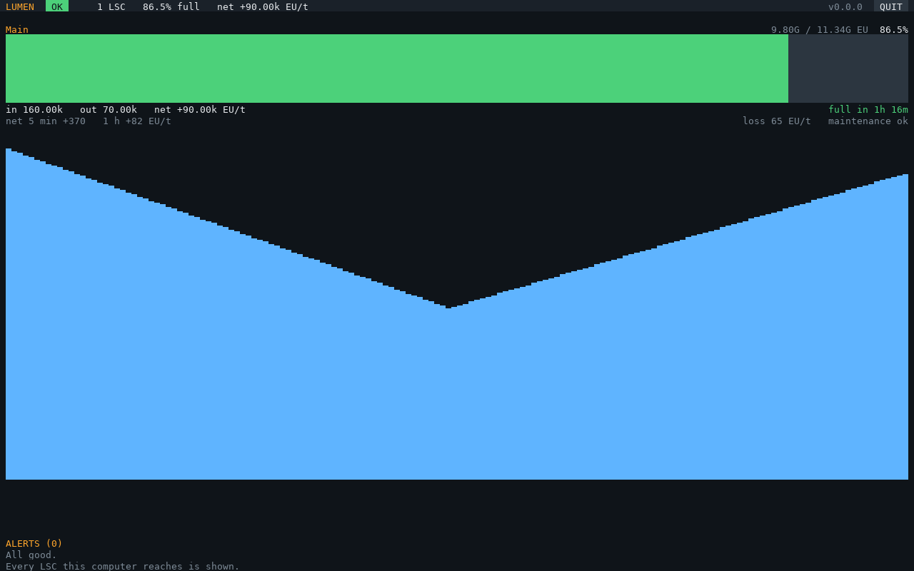
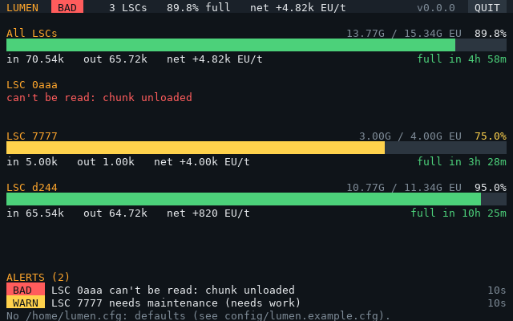

# Setup

## What you need

| Part | Why |
|---|---|
| A computer (tier 2 or better) with a GPU and screen | The display. A **tier 3** screen and GPU give the full layout (160 × 50); tier 2 works (80 × 25). Big multi-block screens look best with a lower `resolution` ([configuration](configuration.md)) |
| An **adapter** on each LSC's controller block | How the computer reads the LSC. The adapter touches the controller, and the computer or a cable connects to the adapter |
| An Internet Card | To install and update. You can take it out afterwards |
| A network card (optional) | Only to report to [LENS](https://github.com/aharabedian/lens) |

One computer shows every LSC it can reach. LSCs too far apart for cable can each have their own LUMEN
computer, all reporting to the same LENS hub.

## Install

```
wget -f https://raw.githubusercontent.com/aharabedian/lumen/main/src/lumen-update.lua /home/lumen-update.lua
/home/lumen-update
```

This installs the programs in `/home/bin` and the modules in `/home/lib/lumen`, plus
`/home/lumen.example.cfg`. Later, `lumen-update` updates everything. It never touches your `/home/lumen.cfg`.

## Run

1. `lumen-discover --read` lists every LSC the computer reaches, with its address. Use it to check the
   adapters are connected.
2. Optional: `cp /home/lumen.example.cfg /home/lumen.cfg` and `edit /home/lumen.cfg` to name the LSCs, change
   the alert levels or turn on LENS reporting ([configuration](configuration.md)). Without a config file,
   LUMEN uses the defaults.
3. Run **`lumen`**. Tap **QUIT** or press Ctrl+C to stop.

To start it on boot, add a line `lumen` to `/home/.shrc`.

## The screen



- **Header:** overall health (OK, WARN, BAD), how many LSCs, how full they are, and the net EU/t.
- **One panel per LSC.** With several LSCs, a panel for **All LSCs** comes first, and on wide screens
  the LSCs sit in two columns. Each panel shows:
  - stored and capacity EU, and the percentage full
  - a fill bar, green, or yellow or red when an alert concerns that LSC
  - the EU/t flowing in and out, and the net (the LSC's own 5-second averages)
  - time to full or empty, as the LSC itself works it out
  - the net over 5 minutes and over 1 hour, passive loss, and maintenance status
  - **a fill history chart** in whatever rows are left (one sample every 30 s, the last 80 minutes)
- **Alerts:** bad ones first, each with how long it has lasted. They clear themselves when the problem goes
  away. A new bad alert beeps once.


On a tier 2 screen, panels keep the essentials:


