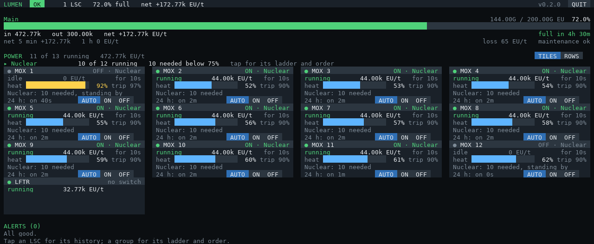
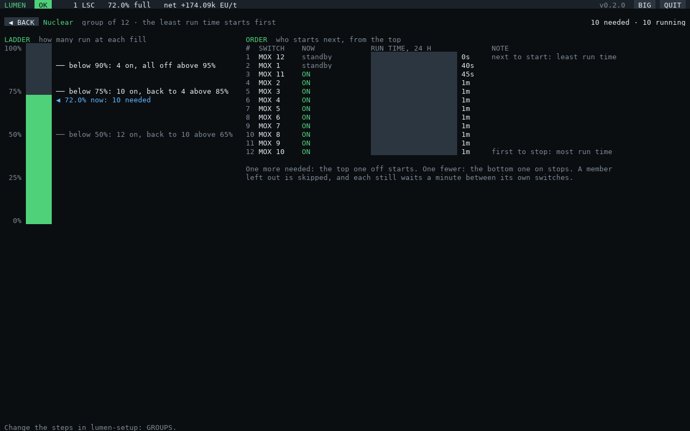
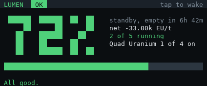
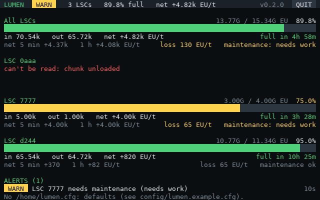
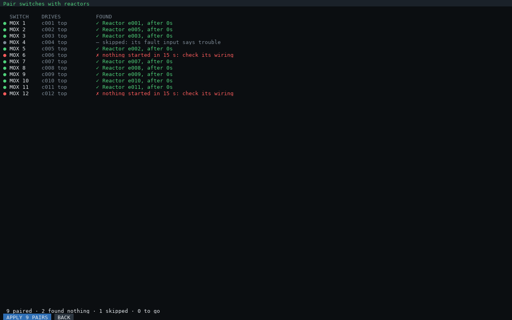

# Setup

## What you need

| Part | Why |
|---|---|
| A computer (tier 2 or better) with a GPU and screen | The display. A **tier 3** screen and GPU give the full layout (160 × 50); tier 2 works (80 × 25). LUMEN fits the text to the screen's shape (a 7 × 3 wall gets 160 × 33); a lower `resolution` gives bigger characters ([configuration](configuration.md)) |
| An **adapter** on each LSC's controller block | How the computer reads the LSC. The adapter touches the controller, and the computer or a cable connects to the adapter |
| Adapters on generators (optional) | To show them under POWER: a GT generator's controller (an LFTR, turbines...) or an IC2 reactor |
| A **Redstone I/O** block or redstone card (optional) | For a [switch](#switches) that runs generators by a redstone signal. A GT generator can be switched through its adapter instead |
| An Internet Card | To install and update. You can take it out afterwards |
| A network card (optional) | Only to report to [LENS](https://github.com/aharabedian/lens) |
| A Computronics **Radar** (optional) | To wake [big mode](#big-mode) as you walk up: the block, touching the computer or cabled to it |

One computer shows every LSC it can reach. LSCs too far apart for cable can each have their own LUMEN
computer, all reporting to the same LENS hub.

## Install

```
wget -f https://raw.githubusercontent.com/aharabedian/lumen/main/src/lumen-update.lua /home/lumen-update.lua
/home/lumen-update
```

This installs the programs in `/home/bin` and the modules in `/home/lib/lumen`, plus
`/home/lumen.example.cfg`. Later, `lumen-update` updates everything. It never touches your `/home/lumen.cfg`.

## Run

1. **`lumen-setup`** finds the LSCs, generators, reactors and redstone components the computer reaches, and
   opens [an editor on the screen](#the-setup-screen) for names, which generators to show,
   [switches](#switches), alerts, LENS, and starting on boot. It shows what changes before saving
   `/home/lumen.cfg` (the old one is kept as `lumen.cfg.bak`). `lumen-setup --text` (or a screen smaller than
   80 × 25) asks the same on the terminal instead; Enter keeps what's there. Run it again any time. Everything
   it writes is in [configuration](configuration.md).
2. Run **`lumen`**. Tap **QUIT** or press Ctrl+C to stop.

Without a config file, LUMEN shows every LSC with the default alerts. `lumen-discover --read` shows what an
LSC or generator reports, to check the adapters are connected.

## The screen


- **Header:** overall health (OK, WARN, BAD), how many LSCs, how full they are, and the net EU/t.
- **One panel per LSC.** With several LSCs, a panel for **All LSCs** comes first, and on wide screens
  the LSCs sit in two columns. Each panel shows:
  - stored and capacity EU, and the percentage full
  - a fill bar, green, or yellow or red when an alert concerns that LSC
  - the EU/t flowing in and out, and the net (the LSC's own 5-second averages)
  - time to full or empty, as the LSC itself works it out
  - the net over 5 minutes and over 1 hour, passive loss, and maintenance status
  - **a fill history chart** in whatever rows are left (one sample every 30 s, the last 80 minutes)
- **POWER** (with sources or switches): each switch with its `source`, as **TILES** or **ROWS** (tap to choose;
  kept across restarts; at first, tiles when there are 4 or more and they all fit). With [groups](#groups), in
  sections: each group's line (how many run and are needed; tap it for its page) with its members under it, then
  **Not in a group** (switches always on or on their own marks, and sources with no switch). Each says ON, OFF, **FAULT** or **TRIP**; what its source
  is doing (running or idle, EU/t); a reactor's heat, on a bar that ends at its [heat trip](#heat-trips); why and for
  how long; **AUTO / ON / OFF** (**ON / OFF** for one that's always on), with **RESET** for a latched fault or a
  trip. A tile's title turns red for
  trouble, readable across the room. When the switch has been off for 10 s and its source still makes power (wired
  wrong?), it says **STILL RUNNING** in red. Sources no switch names get a tile or row of their own.
- **Alerts:** bad ones first, each with how long it has lasted. They clear themselves a minute after the
  problem goes away. A new bad alert beeps once.




**Tap a group** for its page: the **LADDER** (the fill against each step's marks, and how many it needs now) and
the **ORDER** (who starts next, each member's run time over 24 hours, and why one is left out).



### Big mode

After `glanceAfter` seconds (5 minutes) with no tap and nobody near, or when you tap **BIG** in the header, the
screen switches to a few, big characters (`glanceScale` times bigger: 53 × 11 on a 7 × 3 wall): how full in big
digits, time to full or empty, the net, how many sources run, each group, faults and trips, a fill bar, and the
worst alert. Everything else carries on as before (switching, alerts, LENS).



**A tap anywhere wakes it** (and presses nothing underneath). With a Computronics **Radar**, walking up does too:

- A player within `wakeRange` blocks (6; 8 at most, through walls) wakes it within a couple of seconds, and keeps
  it awake while they stand there. `wakePlayers` limits it to some players.
- In big mode LUMEN asks the radar every 2 s. Awake, it asks only when it's about to go big, since each look
  pauses the computer half a second.
- After **BIG**, only someone arriving wakes it, not whoever tapped it.

**Tap an LSC** (or All LSCs) for its page: fill history over **80 MIN**, **8 H** or **24 H**, its averages over 5 s,
5 min and 1 h, time to full or empty, passive loss, maintenance, wireless, capacitors, and **the last 24 hours**
against the 24 before: EU in and out, the highest draw and when, the lowest fill, and how long each switch was
on. **BACK** returns. History survives a restart (in `/home/lumen-state.cfg`).


On a tier 2 screen, panels keep the essentials:



## The setup screen


| Tab | Tap a row to |
|---|---|
| **LSCS** | Name it |
| **SOURCES** | Show a GT machine or not; name it (reactors always show); warn when it stops (**always on**) |
| **SWITCHES** | Change it: name, **Runs** (by fill, with its marks; always; or a group), **REDSTONE** (block, side, **SIGNAL = STOP**) or **GT MACHINE**, the LSC it follows, its source, its [heat trip](#heat-trips), its [fault input](#fault-inputs). **▲ ▼** move it (the order on the main screen), **READ**, **+ NEW**, **COPY**, **DELETE**, **PAIR** |
| **GROUPS** | Change it: name, **Rotate**, the LSC it follows, its steps (**+ STEP**, **REMOVE**). **+ NEW**, **ADD EVERY SWITCH**, **DELETE** |
| **GENERAL** | Alert levels, beep, LENS, start on boot; below, the warnings |

Tap a field to type (Enter keeps it, Esc cancels). A choice ending in ▸ opens a list, saying who already uses
each block. **RESCAN** looks for components again; **TEXT SETUP** switches to the questions.

**Many reactors:** set one switch up, then **COPY** it for each of the others: the copy gets the next name
(MOX 1, MOX 2...) and the next redstone block no switch uses, with the same side, heat trip and fault input
(moved to the new block when it read the old one's). Make a group on **GROUPS** and **ADD EVERY SWITCH**. Then
tap **PAIR** to find each switch's reactor:

1. It explains what it will do, and waits for **START**.
2. Every redstone switch's output goes off, then each switch turns on alone, for up to 15 s, while LUMEN watches
   every reactor. The one that starts making power is its source.
3. It says which it found, and what didn't work: a block that started nothing (check its wiring), more than one
   reactor starting, a switch skipped because its fault input says trouble. A reactor already running at the
   start (something else runs it) is never paired.
4. Every output goes back as it was. **STOP** does that at once. **APPLY** sets the sources; **SAVE** writes them.

Each reactor runs for a few seconds, so have its coolant (and SFM) ready. To tell blocks apart by hand, put a
lever against one (or trip what it watches) and tap **READ**: it says which sides of the switch's blocks have a
signal coming in. An Analyzer shows a block's address too.



**SAVE** lists what changes and warns before writing: a component not found, two switches on one output, a
fault read on a side a switch drives, a source or LSC a switch names that isn't there, a heat trip without a
source, a group with no members or with steps that run more than it has.

## Switches

A switch turns generators **on when the LSCs fall below one mark and off above another** (30% and 90%, say),
and leaves them alone in between so they don't flicker. Or it's **always on** (`always = true`, for a breeder
that should never stop): no marks, **ON / OFF** on the screen, and faults and [heat trips](#heat-trips) still
stop it. Or a [group](#groups) runs it. It's either:

- **A redstone signal** from a Redstone I/O block (or a redstone card), on one side. Wire it to whatever runs
  the generators: an SFM setup that runs a vacuum reactor, a reactor's redstone port, a machine's enable.
  `invert = true` when a signal means *stop*.
- **A GT machine's work switch**, through its adapter (the same as its controller's soft mallet). LUMEN never
  switches an LSC.

It follows all the LSCs together, or one (`lsc`). When LUMEN starts it reads the output as it is, so a restart
never flips anything; it waits a minute between switches; and while it can't read the LSCs it holds. **ON** and
**OFF** on the screen override it (kept across restarts) until **AUTO**.

**Alerts know about switches.** While a switch has its generators off and the LSC is above its on mark, draining
is expected: no drain alert, and the panel says *standby*. Once they've been on for 10 minutes, the drain alert
judges the rate since they came on, so it means "on, and still not keeping up". A switch with a `source` also
warns when it's on and that source isn't running, or off and it still is.

### Fault inputs

A switch can also watch a **fault signal**: a redstone line from whatever it runs that means trouble. LUMEN
doesn't care what's behind it; Steve's Factory Manager's error output on a vacuum reactor is one example.

- A fault shows **FAULT** in red, raises a bad alert (after 5 s, so a glitch isn't one), and, unless
  `stop = false`, switches off at once whatever the mode, until the fault clears. AUTO then waits a minute as
  after any switch.
- `latch = true`: it stays a fault until you tap **RESET**, even once the signal goes. Kept across restarts.
- `invert = true` for an "OK" signal that drops when something fails.
- A fault input that can't be read is an alert of its own; it doesn't switch anything.

LUMEN only reads the line, every `interval`. What it runs keeps its own safety: a Redstone I/O block keeps its
output when its computer stops (seen in game), so if LUMEN isn't running, nothing it switched changes.


### Heat trips

A switch whose `source` is an IC2 reactor can **trip** on its heat: `heatTrip` is a % of the reactor's max heat,
`heatRise` how many % a minute it may climb (judged over at least 30 s). Set them per reactor: MOX and breeder
designs run hot on purpose.

- A trip shows **TRIP** in red, raises a bad alert at once, and switches off whatever the mode. It stays tripped,
  across restarts, until you tap **RESET**.
- An IC2 reactor's heat doesn't change while it's off, and it only cools while it runs. So a **RESET** while it's
  still at or over `heatTrip` lets it run, and trips 5 points higher until it cools below `heatTrip`.
- A reactor that can't be read trips nothing (its own alert says so).

## Groups

A **group** runs several switches together (a hall of reactors, say), as many as the fill needs. Its **steps**
each run some more below a mark and let them go above another, like a switch's marks:

| Step | On below | Back above | Runs |
|---|---|---|---|
| 1 | 90% | 95% | 4 |
| 2 | 75% | 85% | 6 more (10) |
| 3 | 50% | 65% | 2 more (12) |

- **Who runs:** with `rotate` (the default), the members off with the least run time over the last 24 hours start
  first, and the members on with the most stop first, which spreads fuel use and wear. Without it, the order in
  `control`.
- **Left out:** a member set **ON** or **OFF** by hand (until **AUTO**), faulted, tripped, or that can't be switched;
  the next in line takes its place. Each member still waits a minute between its own switches.
- It follows all the LSCs together, or one (`lsc`), and holds while it can't read them. Which steps are on is kept
  across restarts; without that, what's running says.
- A member standing by is *standby* for the drain alerts, as a switch off in AUTO is.
