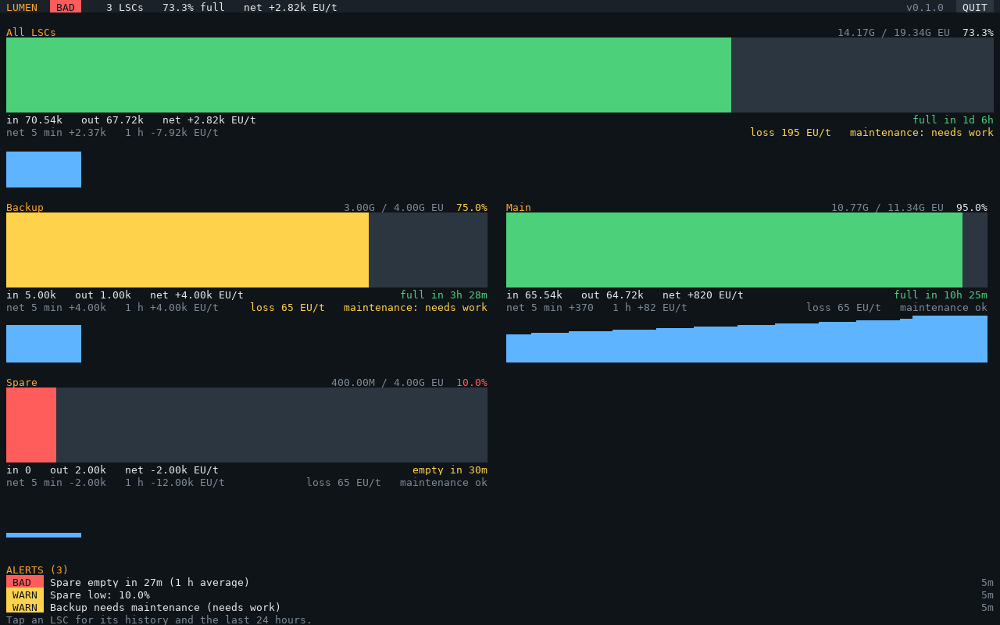
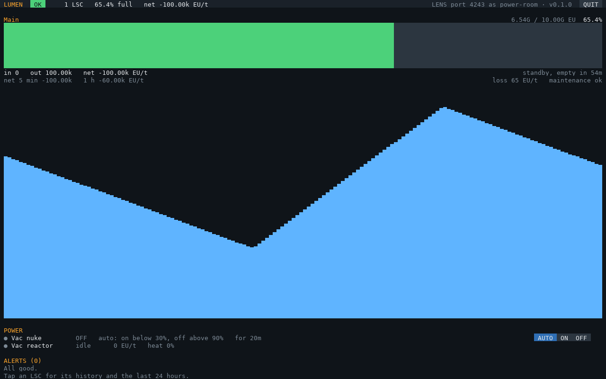
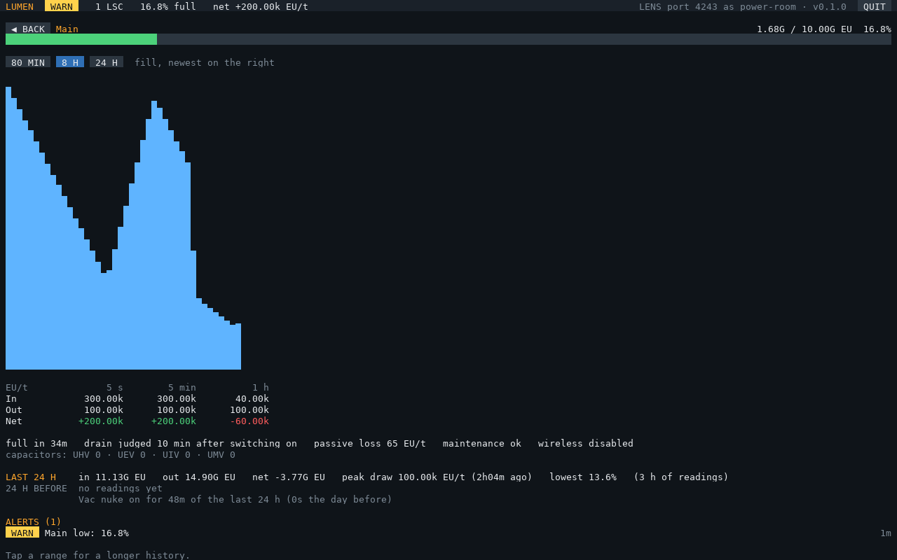

# Setup

## What you need

| Part | Why |
|---|---|
| A computer (tier 2 or better) with a GPU and screen | The display. A **tier 3** screen and GPU give the full layout (160 × 50); tier 2 works (80 × 25). Big multi-block screens look best with a lower `resolution` ([configuration](configuration.md)) |
| An **adapter** on each LSC's controller block | How the computer reads the LSC. The adapter touches the controller, and the computer or a cable connects to the adapter |
| Adapters on generators (optional) | To show them under POWER: a GT generator's controller (an LFTR, turbines...) or an IC2 reactor |
| A **Redstone I/O** block or redstone card (optional) | For a [switch](#switches) that runs generators by a redstone signal. A GT generator can be switched through its adapter instead |
| An Internet Card | To install and update. You can take it out afterwards |
| A network card (optional) | Only to report to [LENS](https://github.com/aharabedian/lens) |

One computer shows every LSC it can reach. LSCs too far apart for cable can each have their own LUMEN
computer, all reporting to the same LENS hub.

## Install

```
wget -f https://raw.githubusercontent.com/aharabedian/lumen/main/src/lumen-update.lua /home/lumen-update.lua
/home/lumen-update
```

This installs the programs in `/home/bin` and the modules in `/home/lib/lumen`, plus
`/home/lumen.example.cfg`. Later, `lumen-update` updates everything. It never touches your `/home/lumen.cfg`.

## Run

1. **`lumen-setup`** finds the LSCs, generators, reactors and redstone components the computer reaches and
   asks: names, which generators to show, [switches](#switches), alert levels, LENS, and starting on boot. It
   shows the file before saving `/home/lumen.cfg` (the old one is kept as `lumen.cfg.bak`). Run it again any
   time; Enter keeps what's there. Everything it writes is in [configuration](configuration.md).
2. Run **`lumen`**. Tap **QUIT** or press Ctrl+C to stop.

Without a config file, LUMEN shows every LSC with the default alerts. `lumen-discover --read` shows what an
LSC or generator reports, to check the adapters are connected.

## The screen


- **Header:** overall health (OK, WARN, BAD), how many LSCs, how full they are, and the net EU/t.
- **One panel per LSC.** With several LSCs, a panel for **All LSCs** comes first, and on wide screens
  the LSCs sit in two columns. Each panel shows:
  - stored and capacity EU, and the percentage full
  - a fill bar, green, or yellow or red when an alert concerns that LSC
  - the EU/t flowing in and out, and the net (the LSC's own 5-second averages)
  - time to full or empty, as the LSC itself works it out
  - the net over 5 minutes and over 1 hour, passive loss, and maintenance status
  - **a fill history chart** in whatever rows are left (one sample every 30 s, the last 80 minutes)
- **POWER** (with sources or switches): a row per switch (ON or OFF, why, for how long, and **AUTO / ON /
  OFF**) and per source (running or idle, EU/t, a reactor's heat, recipe progress, maintenance problems).
- **Alerts:** bad ones first, each with how long it has lasted. They clear themselves a minute after the
  problem goes away. A new bad alert beeps once.





**Tap an LSC** (or All LSCs) for its page: fill history over **80 MIN**, **8 H** or **24 H**, its averages over 5 s,
5 min and 1 h, time to full or empty, passive loss, maintenance, wireless, capacitors, and **the last 24 hours**
against the 24 before: EU in and out, the highest draw and when, the lowest fill, and how long each switch was
on. **BACK** returns. History survives a restart (in `/home/lumen-state.cfg`).



On a tier 2 screen, panels keep the essentials:


## Switches

A switch turns generators **on when the LSCs fall below one mark and off above another** (30% and 90%, say),
and leaves them alone in between so they don't flicker. It's either:

- **A redstone signal** from a Redstone I/O block (or a redstone card), on one side. Wire it to whatever runs
  the generators: an SFM setup that runs a vacuum reactor, a reactor's redstone port, a machine's enable.
  `invert = true` when a signal means *stop*.
- **A GT machine's work switch**, through its adapter (the same as its controller's soft mallet). LUMEN never
  switches an LSC.

It follows all the LSCs together, or one (`lsc`). When LUMEN starts it reads the output as it is, so a restart
never flips anything; it waits a minute between switches; and while it can't read the LSCs it holds. **ON** and
**OFF** on the screen override it (kept across restarts) until **AUTO**.

**Alerts know about switches.** While a switch has its generators off and the LSC is above its on mark, draining
is expected: no drain alert, and the panel says *standby*. Once they've been on for 10 minutes, the drain alert
judges the rate since they came on, so it means "on, and still not keeping up". A switch with a `source` also
warns when it's on and that source isn't running, or off and it still is.
